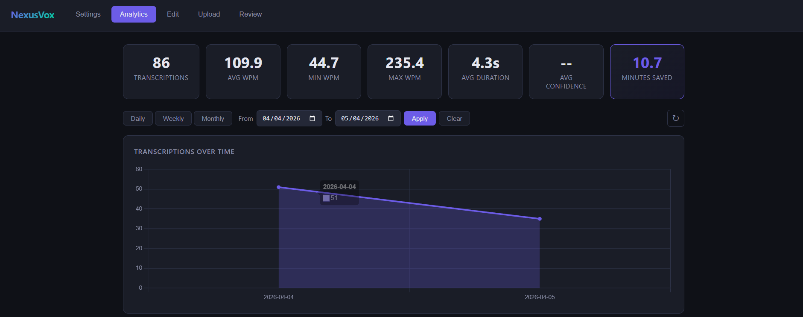

# NexusVox

[](https://github.com/vzwrt13/NexusVox/actions/workflows/ci.yml)
[](LICENSE)
[](pyproject.toml)
[](#platform)

**Local speech-to-text with push-to-talk and auto-insert.**

Hold a hotkey, speak, release — your words appear at the cursor. No cloud, no subscription, no copy-paste.

**An NVIDIA GPU is strongly recommended.** A CPU-only path exists and needs no Docker, but it is slow enough that dictation stops feeling immediate — see [Performance](#performance) for measured numbers before you choose it.

> **Project status.** NexusVox is published as a reference implementation. It is complete and
> working, but not under active development — no new features are planned. Issues and pull
> requests are welcome; responses may be slow.



*Every transcription is stored locally and analysed in the built-in dashboard — words per minute, session length, usage over time.*

---

## Features

- **Push-to-talk** — hold `Ctrl+Shift+Alt`, speak, release; text is injected at the cursor instantly. Or switch to *Toggle* mode in Settings: press once to start, press again to stop
- **Your own hotkey** — any modifiers, optionally ending in a key (`Ctrl+Shift+A`, `F9`, ...), set in Settings → Voice Input with a *Record* button or in `config.toml`. A bound letter is swallowed while it is held as part of the combo, so it never lands in the app you are dictating into
- **GPU-backed transcription** — Voxtral (WebSocket streaming), Cohere and Parakeet run on NVIDIA GPUs via Docker; Whisper runs there too and is far quicker than on CPU
- **CPU fallback** — six Whisper variants and Parakeet (ONNX, int8) run in-process with no Docker and no GPU, for machines that have no other option
- **Nine transcription models** — pick per recording in the dashboard
- **Voice commands** — spoken formatting shortcuts (new line, new paragraph, tab, all caps, punctuation symbols), and an opt-in "press enter" / "Enter drücken" at the end of a dictation that sends a chat message
- **Paste the last text again** — hold the hotkey, tap `V` (`Ctrl+Shift+Alt+V`), let go: nothing is transcribed, the text NexusVox pasted last is pasted once more. The key is set in Settings → Voice Input (or `[hotkey].paste_key`)
- **Rewrite selected text by voice** — select text, hold the hotkey, tap your polish key and say what to do ("make it shorter", "mach es formeller") or nothing for a general clean-up; a local language model rewrites the selection in place (Ctrl+Z undoes it). Needs a model server you run — [Ollama](https://ollama.com) by default, `ollama pull gemma4:e4b` (~4.6 GB VRAM) — or any OpenAI-compatible one under `[llm]`. Off until you pick a key in Settings → Voice Input
- **Polish presets** — keep instructions you use often under a short name (Settings → Polish Presets), e.g. "prompt engineer" or "formelle Mail": say the name instead of the whole instruction, add words after it to adjust it, and mark one as the default for a tap of the polish key without a word
- **Auto cleanup** — off by default; *Light* removes fillers ("um", "äh"), false starts and repeated words and fixes punctuation, *Medium* also grammar. Every dictation goes through the same local model as polish (~0.6 s with `gemma4:e4b`); a reply that does not look like your words cleaned up - an answer, a translation, a lost line break - is ignored and the dictation is typed as spoken. Settings → Voice Input → *Auto Cleanup*
- **Retry a transcription** — in the Review tab, *Retry* transcribes a recording's stored audio again with the current model, e.g. after switching models. Needs *Store Audio Recordings* turned on
- **Snippets** — your own spoken shortcuts: say a trigger phrase ("my address", "meine Signatur") anywhere in a dictation and your stored text is inserted exactly as saved, line breaks included. Create and edit them in Settings → Snippets; none ship with NexusVox. A snippet can hold a list of options, e.g. "open remote repo" with one line per repository (*Fill from GitHub* imports them): "open remote repo nexus vox" inserts the best-matching URL, and "nexus open remote repo nexus vox" / "nexus öffne …" opens it in your browser instead
- **Learn from edits** — fix a misheard word right in the app you dictated into, and NexusVox suggests a correction-dictionary entry for it; you accept or dismiss it in Settings → Correction Dictionary. It reads the text field through UI Automation for 20 seconds after a paste (`window_s`), never password fields or terminals (they expose no readable text). Under the toggle the dashboard says how the last paste ended - suggestions, nothing corrected, or why it was skipped. Off by default, `[learn_from_edits]` in `config.toml`
- **Nexus OS commands** — window management via voice ("nexus open chrome", "nexus minimize")
- **Assistant forward** — "nexus assistant <anything>" hands the sentence to a local voice assistant over a TCP port instead of typing it (off by default, `[assistant]` in `config.toml`); if nothing answers, the text is typed as usual. The assistant is a separate program you provide — see [docs/CONTROL_PORT.md](docs/CONTROL_PORT.md)
- **Command recordings** — add `Y` to the hotkey (`Ctrl+Shift+Alt+Y`) and that recording is not typed but sent as a command to a local program over a TCP port, for example a window switcher that understands "focus 3" (off by default, `[os_control]` in `config.toml`). Without the full chord `Y` types normally. The receiving program is not part of this project — see [docs/CONTROL_PORT.md](docs/CONTROL_PORT.md) for the contract
- **Translate to English** — dictate in German, English or a mix and have the English version typed, while the recording and transcript are stored as spoken; a tray or dashboard toggle (off by default, `[translator]` in `config.toml`). NexusVox does not translate itself: it needs a separate local translator server that is not part of this project — see [docs/TRANSLATOR.md](docs/TRANSLATOR.md). If the server does not answer, the original text is typed
- **Mute other apps' microphone while you dictate** — while the push-to-talk keys are held, every other app's WASAPI microphone session is muted so your dictation is not broadcast to a call; on release each app is put back exactly as it was, and an app you muted yourself stays muted. Per-app mute, never the microphone device; a crash mid-hold is repaired on the next start. Verified with browser calls (Chrome/WebRTC goes silent within 300 ms). Off by default; toggle in Settings → Voice Input or `[mic_guard]` in `config.toml`. **Discord's desktop app ignores per-session mute** (its voice engine reads the raw input): for Discord, bind its *Push to Mute* keybind to the same keys as the NexusVox hotkey — that is the reliable way and needs nothing from NexusVox
- **Flask dashboard** — analytics, settings, transcription history, audio review, and file upload on `http://localhost:47392`
- **Beep feedback** — audio chimes on recording start and stop
- **SQLite history** — every transcription is saved with audio for review and flagging
- **Auto language detection** — per-recording language switching (English/German)

---

## Requirements

- **Windows 11** (Win32 SendInput + pynput hooks)
- **Python 3.11+**

**Recommended — NVIDIA GPU** (Voxtral / Cohere / Parakeet, and a much faster Whisper):
- **NVIDIA GPU** with CUDA runtime installed (VRAM depends on model — see table below)
- **Docker Desktop** + [NVIDIA Container Toolkit](https://docs.nvidia.com/datacenter/cloud-native/container-toolkit/latest/install-guide.html)

**Fallback — CPU only** (Whisper in-process, no Docker):
- No additional dependencies — `pip install` and you're done.
- Expect a noticeable wait after every utterance. Read [Performance](#performance) first; on CPU you are choosing between accuracy and responsiveness, and cannot have both.

**Optional — a local translator server:** only needed for the *Translate to English* toggle. It is a separate program, not shipped with NexusVox; [docs/TRANSLATOR.md](docs/TRANSLATOR.md) describes the one-endpoint HTTP contract so you can run your own. Without it the toggle has no effect and the dashboard says so.

**Optional — a program on the control port:** only needed for *Command recordings* and the *Assistant forward*. It is a separate program, not shipped with NexusVox; [docs/CONTROL_PORT.md](docs/CONTROL_PORT.md) describes the one-line TCP contract and has a minimal example server. Both features are off by default.

**Optional — an extension package:** NexusVox loads installed packages that register under the `nexusvox.extensions` entry-point group and can add a step after a file upload, dashboard tabs and export formats. None ships with NexusVox; [docs/EXTENSIONS.md](docs/EXTENSIONS.md) describes the interface. Without one nothing changes.

**Optional — [ffmpeg](https://ffmpeg.org/) on your `PATH`:** only needed to upload non-WAV audio files (MP3, FLAC, OGG, WEBM) in the dashboard's Upload tab. WAV uploads and push-to-talk dictation work without it. Install with `winget install Gyan.FFmpeg`, then verify with `ffmpeg -version`.

---

## Quick Start (GPU — recommended)

```bash
# 1. Start the Parakeet inference server (~2 GB VRAM)
cd docker && docker compose --profile parakeet up --build

# 2. Install
pip install -e .

# 3. Run
python -m nexusvox
```

Parakeet is the default because it is both the fastest and the most accurate model measured (see [Performance](#performance)) and needs only ~2 GB of VRAM. Voxtral offers WebSocket streaming but wants **≥16 GB** — switch to it in the dashboard Settings tab if your card has the headroom, and the server URL follows automatically.

## Quick Start (CPU — fallback)

```bash
pip install -e .
python -m nexusvox
```

Without a usable GPU, Parakeet runs in-process on the CPU (ONNX, int8 — no Docker); Voxtral and Cohere need a GPU, and a config that names one of them starts on Whisper for that session instead. Open the dashboard at `http://localhost:47392` → Settings → **Model** to pick another CPU-capable entry — `whisper-small` for speed, `whisper-medium` for accuracy — or set `[inference].model = "whisper-small"` in `config.toml` before the first run.

Models download on first use (~670 MB for Parakeet on CPU, ~150 MB for `whisper-small`, ~1.5 GB for `whisper-large-v3-turbo`) and cache under `%USERPROFILE%\.cache\huggingface`; the dashboard's Settings tab shows the download while it runs. Speaker detection for uploads needs the Parakeet GPU container.

See [GettingStarted.md](GettingStarted.md) for the full setup guide including configuration, model selection, and troubleshooting.

---

## Model Backends

| Model | Hugging Face ID | Model license | Runtime | Resources | Docker? |
|---|---|---|---|---|---|
| Whisper Small (CPU-optimized) | `Systran/faster-whisper-small` | MIT | in-process | CPU (~500 MB RAM) | **No** |
| Whisper Base (CPU) | `Systran/faster-whisper-base` | MIT | in-process | CPU (~300 MB RAM) | **No** |
| Whisper Medium (CPU) | `Systran/faster-whisper-medium` | MIT | in-process | CPU (~1.5 GB RAM) | **No** |
| Distil-Whisper Medium.en (EN, CPU) | `Systran/faster-distil-whisper-medium.en` | MIT | in-process | CPU (~800 MB RAM) | **No** |
| Distil-Whisper Large V3 (EN, CPU) | `Systran/faster-distil-whisper-large-v3` | MIT | in-process | CPU (~1.5 GB RAM) | **No** |
| Whisper Large V3 Turbo | `deepdml/faster-whisper-large-v3-turbo-ct2` | MIT | in-process (CPU) / Docker (GPU) | CPU or ~4 GB VRAM | **No** on CPU |
| Parakeet TDT 0.6B | `nvidia/parakeet-tdt-0.6b-v3` | CC-BY-4.0 ² | Docker (GPU) / in-process ONNX int8 (CPU) | ~2 GB VRAM, or CPU (~670 MB download) | Yes on GPU |
| Cohere Transcribe | `CohereLabs/cohere-transcribe-03-2026` | Apache-2.0 ¹ | Docker | ~6 GB VRAM | Yes |
| Voxtral Mini 4B | `mistralai/Voxtral-Mini-4B-Realtime-2602` | Apache-2.0 | Docker | ≥16 GB VRAM | Yes |
| Custom server ³ | — | your server's | your own server | none on this PC | **No** |

¹ **Gated on Hugging Face.** You must accept the terms on the model page and supply an `HF_TOKEN` before the container can download it. All other models download without a token.
² **Attribution required.** CC-BY-4.0 obliges you to credit NVIDIA if you redistribute the model.
³ **Your own backend.** Any server that speaks the OpenAI-compatible HTTP or vLLM realtime WebSocket protocol, set under `[inference.custom]`. Audio leaves this PC if the server is remote — see [docs/CUSTOM_SERVER.md](docs/CUSTOM_SERVER.md).

Model licenses are **separate from NexusVox's own license** — NexusVox is AGPL-3.0, but no model weights ship with it; each model is downloaded from Hugging Face under its own terms. Check the license of the model you pick, especially for commercial use.

Select your device in the dashboard Settings tab: `Auto` (detect CUDA, fall back to CPU), `GPU (CUDA)`, or `CPU`. On CPU, only the entries that run in-process are shown (Parakeet among them, without speaker detection).

---

## Performance

Measured on the FLEURS test set with `scripts/benchmark.py`. **RTF** (real-time factor) is wall time divided by audio duration — RTF 0.05 means a 10-second utterance takes half a second to transcribe. **WER** is word error rate. Lower is better for both.

| Model | Device | Language | RTF | WER | 10 s of speech takes |
|---|---|---|---:|---:|---:|
| Parakeet TDT 0.6B | GPU | English | 0.017 | 5.8 % | 0.17 s |
| Parakeet TDT 0.6B | GPU | German | 0.012 | 5.2 % | 0.12 s |
| Whisper Large V3 Turbo | GPU | English | 0.055 | 5.6 % | 0.55 s |
| Whisper Large V3 Turbo | GPU | German | 0.048 | 5.8 % | 0.48 s |
| Whisper Medium | CPU | English | 0.681 | 5.6 % | **6.8 s** |
| Whisper Small | CPU | English | 0.235 | 7.5 % | 2.4 s |
| Whisper Small | CPU | German | 0.186 | 10.3 % | 1.9 s |

**Why a GPU is recommended.** On CPU you have to choose between accuracy and responsiveness, and you cannot have both:

- **Whisper Medium** reaches GPU-grade accuracy on CPU — 5.6 % WER, the same as Whisper Large V3 Turbo on GPU — but takes **6.8 seconds** for a 10-second utterance. That is 12× slower than the same accuracy on GPU, and 40× slower than Parakeet. Push-to-talk stops feeling like dictation and starts feeling like a batch job.
- **Whisper Small** is quick enough to be usable, but pays for it in errors: 7.5 % WER in English and **10.3 % in German** — twice Parakeet's German error rate. Word error rate is per word, not per sentence: at 10.3 %, a 15-word sentence averages more than one wrong word, so you are correcting almost every sentence by hand.
- On GPU there is no trade-off. Parakeet delivers 5.2 % WER in German *and* returns a 10-second utterance in about an eighth of a second.

A responsive push-to-talk experience needs roughly **RTF ≤ 0.20** (see [docs/BENCHMARK_GUIDE.md](docs/BENCHMARK_GUIDE.md)). Only the German Whisper Small run clears that bar on CPU, and it is the least accurate configuration measured.

**How to read these numbers.** They come from one machine — a 16 GB NVIDIA GPU for the GPU rows, that machine's CPU for the CPU rows — so treat the ratios as meaningful and the absolute values as indicative. The GPU rows cover the full FLEURS test split (647 English / 862 German samples); the CPU rows use 200 samples each, because a full CPU run takes hours. FLEURS is read speech, so real dictation with background noise and hesitation will score worse than any row here.

Reproduce with `python scripts/benchmark.py` — see [docs/BENCHMARK_GUIDE.md](docs/BENCHMARK_GUIDE.md).

---

## Dashboard

Open `http://localhost:47392` while NexusVox is running:

| Tab | Description |
|---|---|
| Analytics | Word count, session stats, usage charts |
| Settings | Model switcher, config editor, voice command toggles |
| Edit | Correct transcriptions in-line |
| Upload | Transcribe audio files (WAV, MP3, FLAC, OGG, WEBM — all but WAV need ffmpeg); optional speaker detection with Parakeet; optional text cleanup with the local language model |
| Review | Flag and replay recordings |


**Speaker detection (Parakeet on GPU only).** In the Upload tab, choose a file, switch on *Detect speakers* and click *Transcribe*; the transcript comes back as `Speaker 1: …` paragraphs, one per turn. The Parakeet container runs NVIDIA's [Streaming Sortformer](https://huggingface.co/nvidia/diar_streaming_sortformer_4spk-v2) (`nvidia/diar_streaming_sortformer_4spk-v2`, CC-BY-4.0, ~0.5 GB download, no token) once over the whole file; it is loaded on the first upload that asks for it and only occupies the GPU while it runs, so a dictation made during that run waits a few seconds. It tells **at most 4 speakers** apart — with more, voices get merged. If the container was built before this feature, rebuild it (`docker compose --profile parakeet up --build`).

*Models are switched from the Settings tab. Selecting a GPU-backed model restarts the matching Docker container and points the app at the right port; the panel below shows what you are switching to.*

---

## Documentation

- [GettingStarted.md](GettingStarted.md) — full setup guide
- [CONTRIBUTING.md](CONTRIBUTING.md) — dev setup, lint, tests, PR conventions
- [docs/TESTING.md](docs/TESTING.md) — running the test suite
- [docs/architecture.html](docs/architecture.html) — interactive component diagram: inputs, transcription backends, storage, dashboard and the local services NexusVox talks to (download and open in a browser)
- [docs/text-pipeline.html](docs/text-pipeline.html) — interactive diagram of one dictation: which commands end the cycle early, the text pipeline in order, injection and learn from edits
- [docs/TRANSLATOR.md](docs/TRANSLATOR.md) — the external translator server behind *Translate to English*
- [docs/CONTROL_PORT.md](docs/CONTROL_PORT.md) — the external program behind *Command recordings* and the *Assistant forward*
- [docs/CUSTOM_SERVER.md](docs/CUSTOM_SERVER.md) — pointing NexusVox at your own transcription server, and the two protocols it must speak
- [SECURITY.md](SECURITY.md) — what NexusVox does on your machine, and how to report a vulnerability

---

## Platform

Windows 11 only. NexusVox uses Win32 APIs (`SendInput`, `WM_PASTE`) for text injection and pynput win32 hooks for the global hotkey listener — these are not portable to macOS or Linux.

---

## Free and Pro (coming soon)

The **core of NexusVox stays free and open source under the AGPL-3.0-or-later**. That includes dictation, polish, auto cleanup, file upload transcription and speaker detection. Basic export is planned as a free feature. Nothing listed here is going to become paid.

**Pro** is a separate, commercial extension that sits next to the core. It adds on top of NexusVox and does not take anything away from it.

Pro is being built and is not on sale yet. The first planned Pro features are local summaries and minutes templates; there are no dates yet.

A commercial licence for the core itself (for example to use it without the AGPL's source-sharing terms) is available on request: info@nightshift-ai.de. Contributions are accepted under the [CLA](CONTRIBUTING.md#contributor-license-agreement-cla), which is what makes this possible.

---

## Contributing

Bug reports and pull requests are welcome — see [CONTRIBUTING.md](CONTRIBUTING.md) for the dev setup, lint and test commands, and branch conventions. Please read the project status above first, so you know what to expect before spending time on a change.

---

## License

NexusVox is licensed under the **GNU Affero General Public License v3.0 or later** — see [LICENSE](LICENSE).

In practice: use it, study it, change it, run it — privately or inside your company — as much as you like. If you distribute a modified version, or offer one to others over a network, you must make your source available under the same license. That is the whole deal: improvements to NexusVox stay available to everyone.

If those terms don't fit your case, a separate commercial license can be arranged with the copyright holder (NightShift AI GmbH, info@nightshift-ai.de).

[THIRD_PARTY_LICENSES.md](THIRD_PARTY_LICENSES.md) covers the bundled Chart.js (MIT), the licenses of the runtime dependencies and the speaker detection model.

Speech recognition models are **not** covered by this license. They are downloaded from Hugging Face at runtime under their own terms — see the [model table](#model-backends) above.
